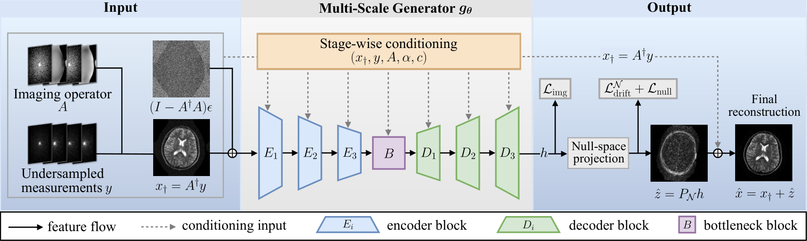
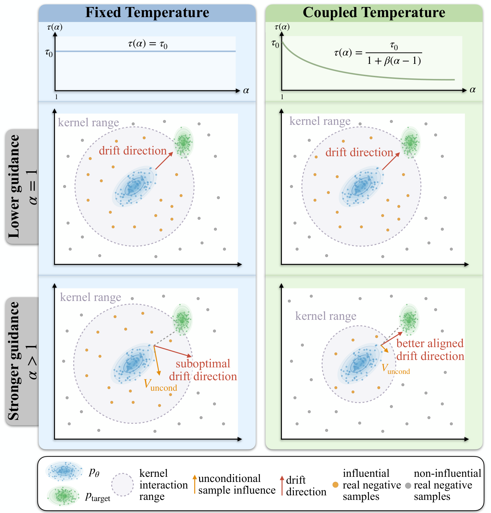
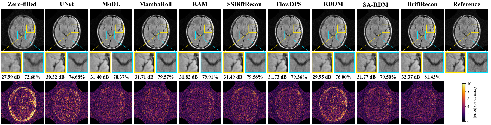
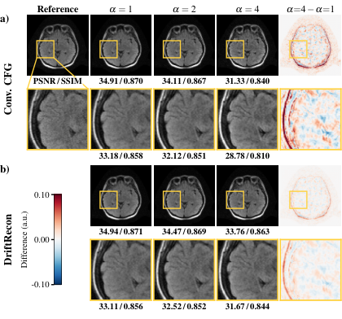

[← Research notes](../blog.qmd){.article-back}

::: {.article-meta-strip}
**Paper:** [Guidance-Coupled Nullspace Drifting for One-Step Medical Image Reconstruction](https://arxiv.org/abs/2610.38953) (arXiv:2610.38953, eess.IV)
**Authors:** M. Tuna Alatan, Agah Server Tapan, Şaban Öztürk, Muhammad Usama Mirza, Bilal Kabas, Ge Wang, Tolga Çukur
:::

::: {.callout-note appearance="simple" icon="false"}
**TL;DR.** DriftRecon is a generative reconstructor that produces an
image in **one forward pass**. Training and generation are confined to
the **nullspace of the imaging operator**, so every output agrees
exactly with the acquired measurements and no post-hoc
data-consistency step is needed. A **guidance parameter** $\alpha$
trades fidelity for realism at inference time. A
**guidance-dependent temperature schedule** limits how much fidelity
is lost as $\alpha$ grows. On sparse-view CT and accelerated MRI it
beats physics-driven unrolled networks, few-step diffusion/flow
methods, and recent drifting models.
:::

## Why one-step generative reconstruction?

Undersampled acquisitions (fewer CT projection views, skipped MRI
phase-encode lines) give an ill-posed inverse problem

$$ y = A x^\star, $$

where $A$ is the imaging operator, $y$ the measurements, and
$x^\star$ the image we want. Generative priors (diffusion, flow
matching) produce realistic texture where regression-trained networks
oversmooth. They usually need many network evaluations, though, and
that cost is hard to justify clinically.

*Drifting models* offer a way around this. They do the iterative
distribution matching during **training**: a kernel-based
attraction–repulsion field pulls generated samples toward real data,
and the generator learns to regress onto that moving target. At test
time one evaluation is enough. Earlier drifting methods for medical
imaging (RDDM, SA-RDM) apply the drift in the full image space. Part
of each update then moves components that the measurements already
determine, and a final data-consistency projection throws that part
away.

## Range–nullspace view

With the pseudoinverse $A^\dagger$, every image consistent with $y$
lives on an affine set:

$$ x^\star = \underbrace{A^\dagger y}_{x_\dagger} \;+\;
\underbrace{(I - A^\dagger A)\,x^\star}_{z^\star \,\in\,
\mathcal{N}(A)}, \qquad P_{\mathcal{N}} = I - A^\dagger A. $$

The anchor $x_\dagger$ is fixed by the data. The *only* thing a
reconstructor needs to infer is the nullspace component $z^\star$:
the part of the image the scanner did not see.

{#fig-nullspace fig-alt="Conventional drifting versus nullspace drifting across early, mid and late training" width="70%" fig-align="center"}

## Method

### Nullspace drifting

DriftRecon draws noise, projects it onto the nullspace, and runs it
through a generator $g_\theta$ conditioned on the anchor, the operator,
the measurements, and the guidance strength. The output is projected
back onto the nullspace:

$$ \varepsilon^{\mathcal N} = \sigma P_{\mathcal N}\varepsilon,
\qquad \hat z = P_{\mathcal N}\, g_\theta(\varepsilon^{\mathcal N},
x_\dagger, A, y, \alpha), \qquad \hat x = x_\dagger + \hat z. $$

Since $A P_{\mathcal N} = 0$, we get $A\hat x = y$ **exactly**, for
every sample, at every point in training.

The drift field is also built entirely in $\mathcal N(A)$. The
positive is the true nullspace component $z^\star$. The negatives are
a second generated sample, plus nullspace components of *other*
images in the batch (mismatched reals). Every input lies in the
nullspace, so the drift does too. The generator is trained with a
stop-gradient regression

$$ \mathcal L_{\text{drift}} = \big\| \hat z - \mathrm{sg}(\hat z +
V^{\mathcal N}) \big\|_2^2, $$

applied over the subbands of a multilevel Haar wavelet decomposition
(for CT), with small auxiliary image- and nullspace-domain losses.

### Physics-conditioned multiscale generator

The generator is a four-level convolutional encoder–decoder. Following
RAM, it injects **measurement conditioning inside every residual
block**, so the network sees $A$ and $y$ at every resolution and not
only at the input or output. In the ablation below, removing this
conditioning is one of the most damaging changes.

{#fig-architecture fig-alt="DriftRecon generator architecture"}

### Guidance and a temperature schedule to go with it

Guidance in drifting models works by mixing mismatched real images into
the negative set. With weight $1 - 1/\alpha$, the generator is pushed
away from "generic" anatomy and toward the specific target, analogous
to classifier-free guidance. $\alpha = 1$ is purely conditional.
Larger $\alpha$ increases realism, but with a fixed kernel temperature
$\tau$ it also lets *distant* mismatched samples distort the drift,
and fidelity drops quickly.

We look at the relative weight a mismatched negative receives as
$\alpha$ changes and require the guidance-weighted mass near the
decision boundary to stay constant. That condition gives a simple
closed form:

$$ \tau(\alpha) = \frac{\tau_0}{1 + \beta(\alpha - 1)}. $$

Here $\tau_0$ is the temperature at $\alpha = 1$, and $\beta = 0$
recovers ordinary fixed-temperature drifting. Stronger guidance makes
the kernel more local, so supervision stays focused on nearby samples.
The single knob $\alpha$ now controls both the fidelity–realism balance
and the locality of the drift.

{#fig-temperature fig-alt="Fixed versus guidance-dependent temperature in drifting" width="75%" fig-align="center"}

## Experiments

- **Sparse-view CT.** NIH–AAPM–Mayo Low-Dose CT Grand Challenge
  (abdominal), parallel-beam geometry, $R = 6$ and $R = 12$.
- **Accelerated MRI.** M4Raw low-field (0.3 T) multicoil brain MRI
  (T1w, T2w, FLAIR), 2D variable-density masks, $R = 4$ and $R = 8$.
- **Baselines.** Data-driven (FBPConvNet / UNet). Physics-driven
  unrolled (MoDL, MambaRoll, RAM). Few-step generative with five steps
  (SSDiffRecon, FlowDPS). One-step drifting (RDDM, SA-RDM).

### Results

Averaged across acceleration rates (SSIM in %, LPIPS ×100), best
competitor in each column versus DriftRecon at $\alpha = 1$:

| Task | Metric | Best competitor | DriftRecon |
|------|--------|-----------------|------------|
| CT  | PSNR ↑  | 39.31 (MambaRoll) | **39.83** |
| CT  | SSIM ↑  | 94.98 (FlowDPS) | **95.73** |
| CT  | LPIPS ↓ | 2.88 (RDDM) | **1.96** |
| CT  | FID ↓   | 57.12 (RDDM) | **37.45** |
| MRI | PSNR ↑  | 30.95 (RAM) | **31.37** |
| MRI | SSIM ↑  | 80.66 (SA-RDM) | **82.06** |
| MRI | LPIPS ↓ | 8.22 (FlowDPS, SA-RDM) | **6.61** |
| MRI | FID ↓   | 11.80 (FlowDPS) | **8.20** |

So DriftRecon improves the distortion metrics (PSNR/SSIM) and the
perceptual/distributional ones (LPIPS/FID) together. In this setting,
data consistency and realism did not have to be traded against each
other.

![Sparse-view CT at $R=6$ (display window $[-160, 240]$ HU). Bottom row: absolute error maps.](assets/ct_results.png){#fig-ct fig-alt="Sparse-view CT reconstructions from all compared methods"}

{#fig-mri fig-alt="Accelerated MRI reconstructions from all compared methods"}

### What the guidance schedule buys

Raising guidance from $\alpha = 1$ to $\alpha = 4$ costs much less
fidelity with the coupled schedule than with fixed-temperature
(CFG-style) guidance:

| Setting | CT ΔPSNR | MRI ΔPSNR | MRI ΔFID |
|---------|----------|-----------|----------|
| Fixed temperature (CFG) | −2.11 dB | −1.87 dB | +6.86 |
| DriftRecon schedule | **−0.76 dB** | **−0.70 dB** | **+2.24** |

{#fig-alpha fig-alt="Guidance strength sweep for conventional CFG and DriftRecon" width="60%" fig-align="center"}

### Ablations

Removing the main components one at a time (CT $R=6$ / MRI $R=4$,
PSNR in dB):

| Variant | CT | MRI |
|---------|----|-----|
| ℓ₂ training instead of drifting | 39.99 | 31.68 |
| No measurement conditioning | 38.02 | 31.70 |
| Drift in image space + hard DC | 41.91 | 32.01 |
| No auxiliary losses | 41.30 | 32.06 |
| No wavelet (multiscale) loss | 41.21 | 32.15 |
| **Full DriftRecon** | **42.06** | **32.16** |

Drifting itself and physics conditioning matter most. Moving the drift
into the nullspace gives consistent gains over drifting in image space
followed by a DC projection, most visibly in FID (CT 22.20 → 20.27,
MRI 6.99 → 5.88).

### Cost

One forward pass takes about 24 ms per CT slice and 68 ms per MRI
slice, with under 0.75 GB of memory. On CT that is faster than the
five-step diffusion and flow baselines. On MRI it is in the same range
as the few-step methods and slower than the lightest unrolled networks.

## Limitations & next steps

- **Operator accuracy matters.** The nullspace is defined by $A$, so
  errors in coil sensitivities, trajectories, or CT geometry change
  the space we generate in. We do not yet evaluate robustness to
  forward-model mismatch.
- **Scope.** Experiments cover Cartesian-style MRI masks and
  parallel-beam CT. Non-Cartesian MRI and other CT geometries need
  their own operators and nullspace projectors.
- **Global guidance.** $\alpha$ and the schedule are set globally.
  Making them adapt to the acquisition or the measurements is a
  natural extension.
- **Strictly one step.** A nullspace-restricted refinement for a few
  extra steps is proposed in the paper but not yet evaluated.

## Citation

```bibtex
@article{alatan2026driftrecon,
  title   = {Guidance-Coupled Nullspace Drifting for One-Step Medical Image Reconstruction},
  author  = {Alatan, M. Tuna and Tapan, Agah Server and {\"O}zt{\"u}rk, {\c{S}}aban and
             Mirza, Muhammad Usama and Kabas, Bilal and Wang, Ge and {\c{C}}ukur, Tolga},
  journal = {arXiv preprint arXiv:2610.38953},
  year    = {2026}
}
```

*Figures are from the paper. This post is a summary; see the
[preprint](https://arxiv.org/abs/2610.38953) for full derivations,
per-rate tables, and implementation details.*
